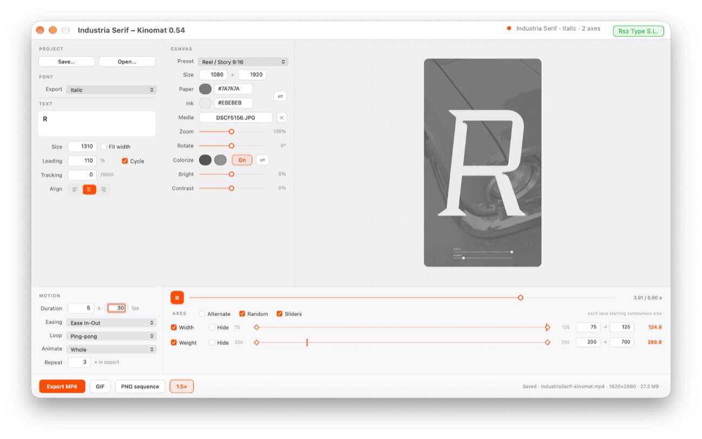
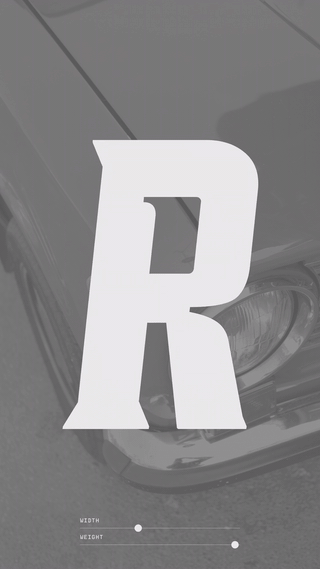

# 🎥 Kinomat

**Version 0.67** — for Glyphs 3 and 4, macOS 10.15 or later.

By Giuseppe Salerno co-founder of [Resistenza Type](https://rsztype.com).

This is a plugin for the [Glyphs font editor](https://glyphsapp.com/). It films the font you are drawing: a word travelling along its own variable axes. No timeline and no keyframes — each axis gets a lane, with a **from** and a **to**.

**Exporting the film — MP4, GIF or PNG sequence — needs the Pro version.** Everything else is the demo, and the demo is the whole panel. One payment, no subscription: **[get the key — €19](https://buy.stripe.com/5kQ5kD5SX38m19New9eQM05)**. The same key opens the tools at [resistenza.es/tools](https://resistenza.es/tools/).

### Final result

The film that panel made, as it came out: *Industria Serif*, its two axes travelling together over a photograph, 15 seconds of it.

[The MP4 it was written as](Kinomat.mp4) — 1080 × 1920, 30 fps. The GIF above is that film cut down to fit on this page.

### Installation

1. Unzip the download and double-click `Kinomat.glyphsPlugin` — Glyphs will offer to install it. (Alternatively, drop it into `~/Library/Application Support/Glyphs 3/Plugins/` or `~/Library/Application Support/Glyphs 4/Plugins/`.)

2. Restart Glyphs.app.

3. The key goes in the top right of the panel, beside the name of the font: the button says *Insert Key* until it carries one.

### Usage Instructions

1. Open a font and choose *Window ▸ Kinomat*, or press ⌘K.
2. Type a word in the box — it opens on the font's own name.
3. Set each lane's **from** and **to**, the ones left ticked are the ones that move.
4. Set the canvas, the paper and the ink, how long the film runs and how fast.
5. **Export MP4**, **GIF** or **PNG sequence**.

The panel opens running, so the word is already moving while you set the rest.

Under *Align* are two boxes for the word's ligatures: **liga**, the standard ones, with clig along with them, and **dlig**, the discretionary ones a font offers and waits to be asked for. They open on and off, as a font expects. The line is measured with the same font it is drawn with, so turning them changes the width the word is centred on too.

The MP4 is written in **H.264**, which plays everywhere — browsers, phones, anything that takes a film. The button beside the size switches it to HEVC: a finer edge on coloured letters, and a film that plays on Macs, iPhones and Safari and nowhere else.

### Which export is filmed

A document can hold more than one variable setting — a Roman and a Stencil, each cancelling the other's masters, or a Serif and a Sans built over the same masters. They are different fonts, with axes of their own, and the panel cannot guess which one you mean. So it asks: a row **FONT ▸ Export** appears in the settings, naming each setting, with the family in front of it where the settings do not all make the same one.

With a single variable setting, or none, there is nothing to choose and the row is not there.

Changing it re-reads the font and rebuilds the lanes around the new axes. Everything else you set is carried across, and a lane whose axis the new setting does not have is left behind, named in the status line.

A document with axes but nothing in Exports to build from does not open the panel at all: Kinomat says that the variable font export is missing and stops. It used to make one up on the spot, over every master with nothing switched off — which came out right and was not the font the document exports, and what is on the screen is taken for the font.

### What the font it films is

Kinomat does not draw from the masters: it exports the font, as Font Info would, and films that — filters, custom parameters and features included. So the film shows the font as it goes out, not the drawing. To keep the wait short, only the glyphs the word needs are exported; type a letter that was not in it and the missing ones are added, once the typing stops.

### Requirements

The plugin requires Glyphs 3 or Glyphs 4, running on macOS 10.15 or later. MP4 and GIF are written by the system's own encoders, so nothing else has to be installed.

### License

Copyright 2026 Giuseppe Salerno / Resistenza Type [rsztype.com](https://rsztype.com).

You may use, modify, and distribute this plugin freely. It is provided as-is, without warranty of any kind.
