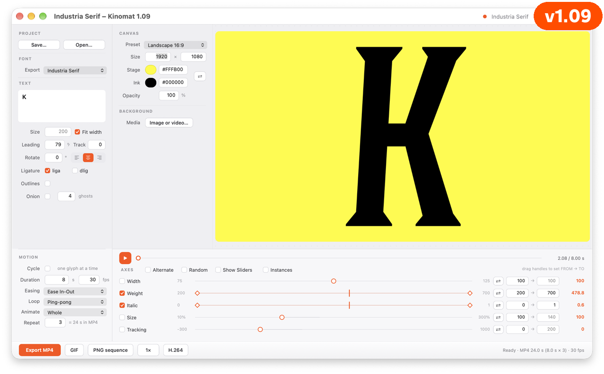
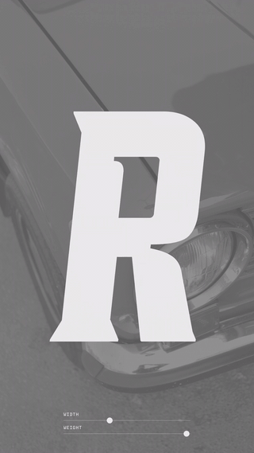
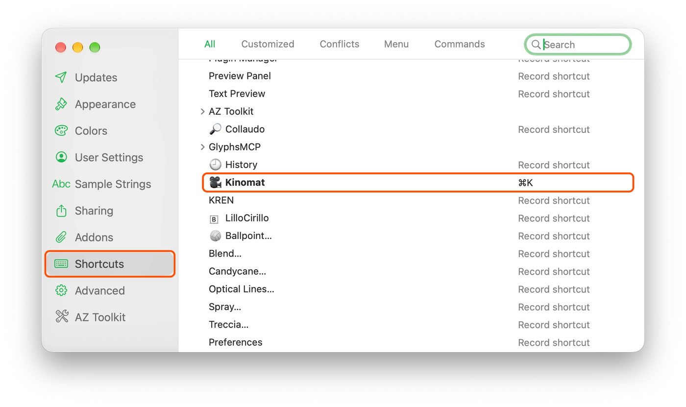

# 🎥 Kinomat

**Version 1.11** — for Glyphs 3 and 4, macOS 10.15 or later.

By Giuseppe Salerno co-founder of [Resistenza Type](https://rsztype.com).

A plugin for the [Glyphs font editor](https://glyphsapp.com/) that turns your variable font into a short animation. Type a word, choose which axes move and between which values, and export it as **MP4**, **GIF** or **PNG sequence** — ready for Instagram, a specimen or a presentation. It always shows the font as it really exports, so you can watch your design in motion while you are still working on it.

**[Read the manual →](https://resistenza.es/glyphs/kinomat.html)**

**Exporting the film needs the Pro version.** Everything else is the demo, and the demo is the whole panel. One payment, no subscription: **[get the key — €19](https://buy.stripe.com/5kQ5kD5SX38m19New9eQM05)**. The same key opens the tools at [resistenza.es/tools](https://resistenza.es/tools/).

### Final result

[The MP4 it was written as](Kinomat.mp4) — 1080 × 1920, 30 fps.

### Installation

Unzip and double-click `Kinomat.glyphsPlugin`, or drop it into `~/Library/Application Support/Glyphs 4/Plugins/`. Restart Glyphs, then *Window ▸ Kinomat*. There is one panel at a time: choosing it again brings it to the front.

**A shortcut of your own.** Kinomat comes without one. In *Glyphs ▸ Settings ▸ Shortcuts* find **Kinomat**, click *Record shortcut* and press the keys — ⌘K, say. It stays through updates, and the *Conflicts* tab tells you if the keys are already taken.

The Pro key goes in the top right of the panel, beside the name of the font: the button says *Insert Key* until it carries one.

### The panel

The green button takes the panel to full screen, and the window's corner makes the whole of it larger or smaller.

The panel opens as you left it: every setting below is written down as you change it, a second after, and comes back the next time — however the window was closed, or Glyphs quit. Lanes return by axis tag, so a font with other axes keeps its own; media behind the word returns with the Pro key.

**PROJECT** — `Save…` and `Open…` write and read a `.rsztools` project: every setting below, the font excluded, since a project takes the font of the Glyphs file that is open. *Pro.*

**FONT** — `Export` picks which of the document's variable exports is filmed, naming each one, with the family in front where they do not all make the same one. The row appears only when there is more than one to choose. Changing it rebuilds the lanes around the new axes and carries the rest of the panel across.

A document with axes films its **variable font export** from *Font Info ▸ Exports*. A design space of one master and a **Virtual Master** (*Font Info ▸ Font ▸ Custom Parameters*), with the far end drawn in brace layers, is a variable font too: its axis gets a lane like any other. Without one, the panel opens on the static font of the master in front, with Size and Tracking for lanes, and the panel says so in orange beside the lanes. A variable export that fails — glyphs not compatible across masters — opens the same way, naming the glyphs.

**TEXT**

| | |
|---|---|
| the box | what is filmed, one line per line. It opens on the font's own name |
| `Size` | in points, on the canvas — with **Fit width** it is set for you, as wide as the canvas allows |
| `Leading` · `Track` | the distance between lines, as a percentage · letter-spacing, per thousand of the em, on top of the font's own kerning |
| `Rotate` · align | turns the text, in degrees, around the middle of the canvas · left, centre, right |
| `Ligatures` | **liga** standard ones, clig with them · **dlig** the discretionary ones. Measured as they are drawn |
| `Outlines` | the letters drawn as outlines only, in the Ink colour |
| `Onion` | onion skin: the frames just gone by stay behind the text as fading ghosts, one every 0.1 s — how many, 1 to 12, in the field. In the preview and in every export |
| a letter's colour | click a letter on the stage: a box of swatches gives it a colour of its own — the house colours, the wheel, lighter and darker, a hex to type, or any colour from the system's panel. *Ink* gives it back. The colour stays with the letter as the text is edited, and is saved in the project |

**CANVAS**

| | |
|---|---|
| `Preset` | Reel / Story 9:16 · Post 1:1 · Post 4:5 · Post 5:4 · Landscape 16:9 · Square 2000 · Custom |
| `Size` | width × height in pixels, if none of those fits |
| `Stage`, `Ink` | the two colours, by picker or by hex. The **⇄** between them is the film in negative |
| `Opacity` | how much of the Ink shows, 0 to 100 %: the stage or the background shows through the letters, and overlapping letters do not darken |

**BACKGROUND**

| | |
|---|---|
| `Media` | an image or a video behind the word — png, jpg, heic, tif, gif, bmp, webp · mov, mp4, m4v. **✕** takes it away. *Pro* |
| `Real time` | a video behind sets the film's length and speed; switched off, Duration and fps are yours again |
| `Zoom`, `Rotate`, `Speed` | how large the media is drawn, which way round, and how fast a video runs |
| `Colorize` | the media in two colours of your choosing — one for its darks, one for its lights — with its own **⇄** |
| `Bright`, `Contrast` | over the media only: the word is never touched |

**MOTION**

| | |
|---|---|
| `Cycle` | instead of the text, one glyph at a time: the ones typed in the box (a line each, one above the other, with more lines), or every glyph of the font with a Unicode value when the box is empty. Each glyph stays on screen 0.3 s, always forward, while the axes move as set: a long list makes the cycle longer, up to 18 s, and the panel says so beside the lanes. Glyphs whose curves cannot be made compatible between masters are left out, and the panel says how many |
| `Duration` | seconds, and `fps` frames a second |
| `Easing` | Linear · Ease In · Ease Out · Ease In-Out · Sine In-Out · Expo In-Out · Back In-Out · Elastic Out · Bounce Out |
| `Loop` | **Ping-pong** out and back · **Restart** out and from the start again · **Play once** |
| `Animate` | **Whole** the text as one, every line together · **Words** · **Letters**, each piece a step behind the one before. A single word has nothing to divide, and the panel says so |
| `Repeat` | how many times the loop runs in the MP4. Beside it, how long the MP4 comes out: Duration × Repeat, or one loop with Play once. A GIF plays one loop, forever |

**THE LANES** — one per axis, then **Size** and **Tracking**, always. With axes those two start switched off; with none they are the whole film.

| | |
|---|---|
| the tick beside the name | this axis moves. Unticked, it stands still |
| diamond or circle | a **diamond** is an end of a movement, **from** and **to**: a ticked lane has two. A **circle** is one value: an unticked lane has one, and drags to the value the axis stands at |
| `from → to` | where the axis starts and ends. The diamonds on the track do the same by hand |
| **⇄** before `from → to` | Reverse: this lane runs from its To back to its From, orange when it is on — in every Loop, with Alternate, Random and Cycle. The fields keep what was typed |
| the number in orange | where the axis is, right now, in the frame on the stage |
| `Alternate` | the lanes one after another, each adding to the ones before |
| `Random` | every lane starts from its own point of the loop, drawn when it was ticked |
| `Show Sliders` | draws the lanes in the film itself. With it on, each lane gets a **Hide** box to leave its own slider out |
| `Instances` | the moving axes stop on the font's named instances on the way — Regular, Bold… — 0.4 s on each, a quarter of a second at least for every move. When the Duration leaves too little time the cycle grows, and the line beside the lanes says how long it runs |

**THE BAR** — `Export MP4`, `GIF`, `PNG sequence`. *Pro.*

Beside them, how large the film comes out — **1×** the canvas, 1.5×, 2× — and the codec: **H.264**, which plays everywhere, or **HEVC**, a finer edge on coloured letters and a film that plays on Apple's machines and nowhere else. The status line says what was written, how large, and in which of the two.

### Requirements

Glyphs 3 or Glyphs 4, macOS 10.15 or later. MP4 and GIF are written by the system's own encoders, so nothing else has to be installed.

### License

Copyright 2026 Giuseppe Salerno / Resistenza Type [rsztype.com](https://rsztype.com).

You may use, modify, and distribute this plugin freely. It is provided as-is, without warranty of any kind.
